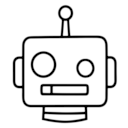

<h3>
  
  Made with AI Logo
</h3>

An open logo for things made with, or with the help of, AI.

### Design philosophy

The logo features a neutral, retro-inspired robot head reminiscent of the robots imagined in the 1940s and 1950s.

One eye is slightly smaller than the other. This is intentional: a small imperfection acknowledging that things made with or assisted by AI, much like things made by humans, don't always turn out exactly as intended.

It is meant as a neutral, recognizable mark for identifying AI involvement, not as an endorsement or criticism of AI itself.

## License

Licensed under [CC BY 4.0](https://creativecommons.org/licenses/by/4.0/). You may use, share and adapt the logo for any purpose, including commercial use and merchandise, as long as you give appropriate credit and indicate if you made changes. The copyright remains with the original author.

## Attribution

> Logo made by MattiP451 with the assistance of AI, licensed under [CC BY 4.0](https://creativecommons.org/licenses/by/4.0/).
